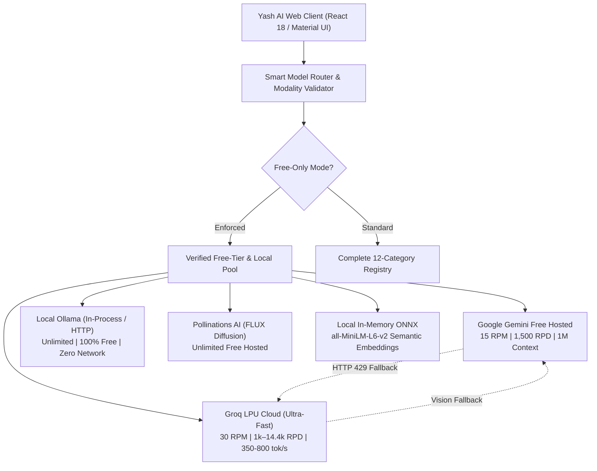

# Yash AI: Comprehensive Multimodal AI Platform Specification & Model Registry

*Platform Version: Yash AI 3.0 Multimodal Platform*  
*Registry Verification Date: October 2026*  
*Architecture: Spring Boot 4.1 + React 18 + Vite + Material UI v5 + Pinecone Vector DB*

---

## 1. Architectural Overview

Yash AI has been upgraded into an enterprise-grade, multimodal AI platform that discovers, evaluates, categorizes, integrates, and manages foundation models that are free to use or offer generous free usage quotas.

The platform architecture enforces:
1. **Modality Validation**: Strict pre-flight checks guarantee that visual, audio, or video inputs are never routed to text-only models, automatically selecting compatibility-aware multimodal models.
2. **Smart Model Routing & Fallback**: Automatic failover on HTTP 429 rate limit or quota exhaustion with zero user disruption.
3. **Free-Only Mode**: A strict toggle that restricts model invocation exclusively to 100% free open weights (e.g. Local Ollama) and verified free-tier inference APIs with zero unexpected billing.
4. **Transparent Rate Limits & Quotas**: Full disclosure of real-world requests-per-minute (RPM), requests-per-day (RPD), tokens-per-minute (TPM), context windows, reset periods, and latency.



---

## 2. The 12 Official Model Categories

All supported models are organized into 12 clearly separated categories. Models with true multi-task support (e.g. Google Gemini 2.5 Flash) appear across all categories they genuinely support:

| # | Category Identifier | Human Label | Modalities & Description | Representative Verified Model |
|---|---------------------|-------------|--------------------------|-------------------------------|
| **1** | `text-generation-and-reasoning` | Text Generation & Reasoning | Text & Code -> Text. General conversation, coding, mathematics, logic, summarization, long-context analysis. | `gemini-2.5-flash`, `llama-3.3-70b-versatile`, `qwen2.5:7b` |
| **2** | `any-to-any-multimodal` | Any-to-Any Multimodal | Text, Image, Audio, Video -> Text, Image, Audio. Multi-turn cross-modal intelligence. | `gemini-2.5-flash`, `gemini-2.5-flash-audio` |
| **3** | `image-and-text-to-text` | Image & Text to Text | Image + Text -> Text. Visual question answering (VQA), chart reading, UI explanation, document reasoning. | `gemini-2.5-flash-vision`, `Qwen/Qwen2.5-VL-7B-Instruct` |
| **4** | `image-to-text` | Image to Text (OCR & Captioning) | Image -> Text. Optical character recognition, document extraction, handwriting recognition, dense captions. | `Salesforce/blip-image-captioning-large`, `microsoft/trocr-base-printed` |
| **5** | `image-to-image` | Image to Image (Editing & Refinement) | Image + Text -> Image. Style transfer, diffusion refinement, upscaling, controlled editing. | `stabilityai/stable-diffusion-xl-refiner-1.0` |
| **6** | `text-to-image` | Text to Image (Diffusion Synthesis) | Text -> Image. Photorealistic diffusion, concept art, typography, wallpaper synthesis. | `flux-schnell-free` (FLUX.1 [schnell]) |
| **7** | `text-to-video` | Text to Video | Text -> Video. Text-prompted short motion synthesis, temporal video generation. | `THUDM/CogVideoX-5B` |
| **8** | `text-to-speech` | Text to Speech (Neural TTS) | Text -> Audio. Neural voice synthesis, Indian language narration, real-time word highlighting. | `google-hosted-tts`, `sarvam-bulbul-v1` |
| **9** | `speech-to-text-and-audio-understanding` | Speech to Text & Audio Understanding | Audio -> Text. Speech transcription, audio question answering, acoustic analysis. | `openai/whisper-large-v3` (Groq LPU) |
| **10** | `audio-to-audio` | Audio to Audio | Audio -> Audio. Speech-to-speech translation, voice cloning, audio style enhancement. | `gemini-2.5-flash-audio` |
| **11** | `video-to-text-and-video-understanding` | Video Understanding | Video + Text -> Text. Video question answering, temporal event recognition, dense video captioning. | `gemini-2.5-flash` |
| **12** | `embeddings-and-reranking` | Embeddings & Reranking | Text -> Dense Vectors. Dense semantic embeddings for Pinecone vector search, neural rerankers for RAG. | `sentence-transformers/all-MiniLM-L6-v2`, `BAAI/bge-m3`, `cohere-rerank-v3` |

---

## 3. Verified Free-Tier Quota Comparison Matrix

The table below provides exact, verified rate limits and allowances as of **October 2026**. Yash AI strictly distinguishes between 100% free open weights, free hosted inference APIs, serverless pools, and trial tiers. Unknown metrics are explicitly marked.

| Model ID | Provider | Free Access Type | Verified Free Quota | Reset Period | Context Window | Latency | License | Required Env Vars | Official URL |
|---|---|---|---|---|---|---|---|---|---|
| `gemini-2.5-flash` | Google Gemini | Free Hosted Tier | **15 RPM / 1,500 RPD / 1M TPM** | Midnight PT | 1,000,000 | ~150ms | Gemini Terms | `GEMINI_API_KEY` | [ai.google.dev](https://ai.google.dev) |
| `gemini-2.5-flash-vision` | Google Gemini | Free Hosted Tier | **15 RPM / 1,500 RPD / 1M TPM** | Midnight PT | 1,000,000 | ~160ms | Gemini Terms | `GEMINI_API_KEY` | [ai.google.dev](https://ai.google.dev) |
| `llama-3.3-70b-versatile` | Groq LPU Cloud | Free Developer Tier | **30 RPM / 1,000 RPD / 100k TPD** | Sliding Window | 131,072 | ~95ms | Llama 3.3 License | `GROQ_API_KEY` | [groq.com](https://groq.com) |
| `llama-3.1-8b-instant` | Groq LPU Cloud | Free Developer Tier | **30 RPM / 14,400 RPD / 500k TPD** | Sliding Window | 131,072 | ~45ms | Llama 3.1 License | `GROQ_API_KEY` | [groq.com](https://groq.com) |
| `openai/whisper-large-v3` | Groq LPU Cloud | Free Developer Tier | **20 Audio Req/min / 2,000 RPD** | Sliding Window | 25MB Audio | ~140ms | MIT License | `GROQ_API_KEY` | [groq.com](https://groq.com) |
| `qwen2.5:7b` | Local Ollama | Open Weights (Local) | **Unlimited (100% Free / Local)** | None (Local) | 32,768 | ~60ms | Apache-2.0 | *None* | [ollama.com](https://ollama.com) |
| `deepseek-r1:8b` | Local Ollama | Open Weights (Local) | **Unlimited (100% Free / Local)** | None (Local) | 65,536 | ~80ms | MIT License | *None* | [ollama.com](https://ollama.com) |
| `flux-schnell-free` | Pollinations AI | Free Hosted Tier | **Unlimited (Zero Token Req)** | None | N/A | ~950ms | Apache-2.0 | *None* | [pollinations.ai](https://pollinations.ai) |
| `blip-image-captioning-large` | Hugging Face | Free Serverless Pool | **20 RPM Free Pool** | Per Minute | 512 | ~280ms | BSD-3-Clause | `HF_TOKEN` (Optional) | [huggingface.co](https://huggingface.co/Salesforce/blip-image-captioning-large) |
| `trocr-base-printed` | Hugging Face | Free Serverless Pool | **20 RPM Free Pool** | Per Minute | 512 | ~310ms | MIT License | `HF_TOKEN` (Optional) | [huggingface.co](https://huggingface.co/microsoft/trocr-base-printed) |
| `google-hosted-tts` | Google Web / WebSpeech | Free Web Tier | **Unlimited Free Web Tier** | None | 5,000 chars | ~80ms | Open Web Standard | *None* | [w3c.github.io/speech-api](https://w3c.github.io/speech-api) |
| `all-MiniLM-L6-v2` | Local ONNX Java | Open Weights (Embedded) | **Unlimited In-Memory Java** | None | 512 | <5ms | Apache-2.0 | *None* | [sbert.net](https://www.sbert.net) |
| `BAAI/bge-m3` | Hugging Face | Free Serverless Pool | **20 RPM Free Pool** | Per Minute | 8,192 | ~120ms | MIT License | `HF_TOKEN` (Optional) | [huggingface.co](https://huggingface.co/BAAI/bge-m3) |
| `cohere-rerank-v3` | Cohere | Free Trial Key | **10 RPM / 1,000 Calls/Month** | Monthly | 4,096 | ~190ms | Cohere Eval Terms | `COHERE_API_KEY` | [cohere.com](https://cohere.com/rerank) |

---

## 4. Provider-Adapter Architecture & Modality Validation

### Modality Validation Rules
When an inference request is dispatched:
1. The request payload is inspected for attached media (`image/*`, `audio/*`, `application/pdf`, etc.).
2. The selected model's `supportedInputModalities` are validated against the payload.
3. If an incompatible request is detected (e.g., an image sent to `llama-3.3-70b-versatile` or `qwen2.5:7b`), the engine **refuses to drop or fail the request**. It automatically routes the request to an equivalent multimodal vision model (such as `gemini-2.5-flash-vision`), and emits an informative SSE event `model_switch` to notify the user.

```json
{
  "event": "model_switch",
  "data": {
    "originalModel": "llama-3.3-70b-versatile",
    "activeModel": "gemini-2.5-flash-vision",
    "reason": "Image attachment detected: automatically routed to multimodal vision model (gemini-2.5-flash-vision) for accurate visual understanding."
  }
}
```

### Automatic Fallback on HTTP 429
If Google Gemini encounters an HTTP 429 (Rate Limit Exceeded) on a text query, the system dynamically fails over to the ultra-high-speed **Groq LPU Cloud** (`llama-3.3-70b-versatile`) without duplicate retries or chat disconnection. Conversely, if Groq encounters limits, it falls back to Gemini.

---

## 5. Free-Only Mode

Yash AI includes a system-wide **Free-Only Mode**:
- **Default State**: Enabled (`freeOnlyMode = true`).
- **Guarantee**: Zero unexpected charges. Only endpoints that are 100% free open weights (e.g. Local Ollama, Local ONNX) or have dedicated, non-metered free tiers are permitted.
- **REST Endpoints**:
  - `GET /api/models/live-status`: Returns `freeOnlyMode` status.
  - `POST /api/models/free-only-mode`: Toggles the mode (`{"enabled": true|false}`).

---

## 6. Environment Variables & Setup Guide

Yash AI operates with zero required paid keys. To enable all cloud-hosted free tiers:

| Environment Variable | Target Provider | How to Obtain (Free) |
|---|---|---|
| `GEMINI_API_KEY` | Google Gemini Free Hosted | [Google AI Studio](https://aistudio.google.com/app/apikey) (Free tier: 15 RPM, 1,500 RPD) |
| `GROQ_API_KEY` | Groq LPU Cloud | [Groq Console](https://console.groq.com/keys) (Free tier: 30 RPM, 1,000 RPD) |
| `HF_TOKEN` | Hugging Face Free Serverless | [Hugging Face Settings](https://huggingface.co/settings/tokens) (Free read token) |
| `COHERE_API_KEY` | Cohere Reranker | [Cohere Dashboard](https://dashboard.cohere.com/api-keys) (1,000 free rerank calls/month) |
| *None required* | Local Ollama | Run `ollama run qwen2.5:7b` locally on port 11434 |
| *None required* | Pollinations AI | Direct public free diffusion API |
| *None required* | Local ONNX Embeddings | Bundled in-process Java ONNX runtime |
