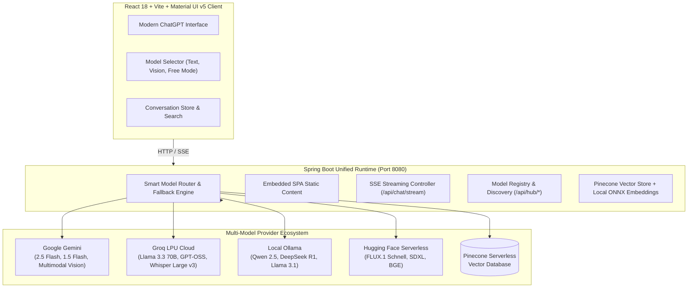

# MultiModel-AI (Yash AI) — Unified Multi-Model & Multimodal Intelligence Platform

A complete, production-ready full-stack AI platform inspired by **ChatGPT**, powered by **React**, **Vite**, **Material UI (MUI v5)**, and a unified **Spring Boot 4 / Java 21** backend on **port 8080**, integrating **Google Gemini**, **OpenAI GPT / Groq**, **Claude-grade reasoning models**, **Hugging Face Inference Providers**, **Local Ollama**, and **Pinecone Vector Database**.

---

## 💡 Why Use Gemini, Claude, and GPT Separately? Here's Why We Combined Them

In today's AI landscape, users and developers face a common frustration: **Why should I be forced to switch between ChatGPT, Claude, and Gemini separately?**

### The Pain of Fragmentation:
1. **Subscription Fatigue & Skyrocketing Costs**:
   - ChatGPT Plus ($20/month) + Claude Pro ($20/month) + Gemini Advanced ($20/month) = **$60+/month ($720+/year)** just to access frontier models.
2. **Tab-Switching & Context Loss**:
   - You write code in Claude, need GPT for tool calling or general tasks, and turn to Gemini for long-document or multimodal image analysis. Copying and pasting prompt histories, attachments, and code snippets across three different browser tabs destroys your flow and loses conversation context.
3. **Every Model Has a Different Superpower**:
   - 🟢 **OpenAI GPT**: Gold standard for general instruction-following, task orchestration, structured JSON outputs, and versatile everyday problem-solving.
   - 🟣 **Anthropic Claude**: Industry benchmark for deep coding, refactoring, nuanced writing, and complex system architecture.
   - 🔵 **Google Gemini**: Massive context window (1M+ tokens), native multimodal vision & audio processing, and lightning-fast free-tier hosted inference.
   - 🟠 **Open Weights & High-Speed Inference (DeepSeek R1, Llama 3.3, Qwen 2.5 Coder via Groq / Ollama / HF)**: Ultra-fast processing (300–800 tokens/sec on Groq), zero-cost privacy running locally via Ollama, and specialized math/reasoning.

---

### The Solution: MultiModel-AI Brings Them Together Under One Roof

**MultiModel-AI** eliminates the silos by merging the world's best frontier and open-source models into a single, cohesive, enterprise-grade interface:

| Problem with Separate Tools | How MultiModel-AI Solves It |
|---|---|
| **Multiple $20/mo Subscriptions** | **Zero Subscription Barrier**: Use generous free-tier APIs (Google Gemini Free, Groq Cloud, Pollinations AI) or 100% free offline local models (Ollama). |
| **Scattered Conversation History** | **Unified Chat Experience**: Switch between Gemini, GPT, DeepSeek, and Llama on the fly in the exact same chat thread with full context preservation. |
| **Model Inflexibility & Lock-in** | **Intelligent Routing & Failover**: Automatic failover (e.g., if one provider hits HTTP 429 rate limits, it dynamically routes to an alternative model with zero downtime). |
| **Text-Only Limitations** | **True Multimodal Hub**: Combines Text-to-Text, Image-to-Text (Vision/OCR), Text-to-Image (FLUX.1 Schnell / SDXL), Speech-to-Text (Whisper Large v3), Text-to-Speech (Neural TTS), and Vector RAG (Pinecone) in one dashboard. |
| **Privacy Concerns** | **Local & Cloud Hybrid**: Toggle between hosted cloud models and 100% private, offline models running through local Ollama. |

---

## 🌟 Key Features

### 1. 🎨 Modern ChatGPT-Style Frontend (React + Vite + MUI v5)
- **Minimalist, responsive interface** inspired by modern ChatGPT with dark and light theme support (`MUI ThemeProvider`).
- **Collapsible left sidebar**:
  - App branding with status pills.
  - Prominent **New Chat** button.
  - Searchable conversation history with instant keyword filtering.
  - Conversation management with contextual **Rename** and **Delete** actions.
  - Profile & user settings panel showing Pinecone, Hugging Face, Groq, and Gemini connectivity.
- **Main Chat Experience**:
  - Centered welcome screen with starter prompt cards (Coding, Image Generation, Deep Reasoning, Vector Search).
  - Clean user and assistant message bubbles with custom avatars.
  - Complete **Markdown rendering** (lists, tables, blockquotes, bold/italics).
  - Formatted **Code Blocks** with syntax highlighting, language headers, and one-click **Copy Code** feedback.
  - **Assistant Action Bar**: Copy response, Regenerate response, model badge indicator, latency/duration stats.
  - **Dynamic Follow-up Suggestions**: Context-aware question chips rendered at the end of assistant answers that submit as the next user prompt.
- **Message Composer**:
  - Auto-expanding multiline prompt composer (`Enter` to send, `Shift+Enter` for newline).
  - **Stop Generation** button with abort signal support during live streaming.
  - Image and document attachment support with thumbnail preview chips and removal controls.

### 2. ⚡ Dedicated Sections for Model Selection (Text-to-Text & Free Image-to-Text)
- **Top-Bar Model Selector with Dedicated Sections**:
  - **Section 1: Text-to-Text Models**:
    - Houses text generation, reasoning, and coding models.
    - Includes: `Gemini 2.5 Flash`, `Gemini 1.5 Flash`, `Qwen 3.8 27B (Groq)`, `OpenAI GPT-OSS 120B (Groq)`, `Llama 3.3 70B (Groq)`, `DeepSeek R1 (Ollama)`, `Qwen 2.5 7B (Local Ollama)`, `Llama 3.1 8B (Local Ollama)`, `Qwen 2.5 7B Instruct (HF)`, `Meta Llama 3.1 8B (HF)`, `Gemma 3 4B Instruct (HF)`, `Microsoft Phi-4 (HF)`.
  - **Section 2: Image-to-Text Models (100% Free)**:
    - Dedicated to free models specifically trained to analyze images and generate textual responses based on visual inputs (multimodal VLM & OCR).
    - Includes: `Gemini 2.5 Flash Vision` (Free Hosted), `Gemini 1.5 Flash Vision` (Free Hosted), `Llama 3.2 11B Vision` (Free Open-Weights), `Qwen 2.5 VL 7B Instruct` (Free Open-Weights), `Microsoft Florence-2 Base` (Free MIT), `Moondream 2` (Free Compact VLM), `Pollinations Vision` (100% Free Hosted).
- **Expanded Capabilities**:
  - 🎨 **Image Generation (Text-to-Image / Image-to-Image)** (`FLUX.1 Schnell`, `Stable Diffusion XL`)
  - 🎙️ **Speech Recognition (ASR)** (`Whisper Large v3`, `Whisper Large v3 Turbo`, `Nemotron 3.5 ASR`)
  - 🔊 **Text-to-Speech (TTS)** (`Meta MMS TTS`, `Parler-TTS`, `Google Web TTS`, `Sarvam`)
  - 🎥 **Video Generation (Text-to-Video)** (`ModelScope Damo`, `CogVideoX`)
  - 📚 **Embeddings & Feature Extraction** (`all-MiniLM-L6-v2`, `BGE Small EN v1.5`)
- **Smart Automatic Model Selection & Fallback**:
  - Automatically routes queries based on modality and intent (e.g. image attachments route automatically to Vision VLMs; code requests route to optimized coder models).
  - Gracefully recovers from HTTP 429 rate limits or credit limits by failing over to verified backup endpoints (e.g., Gemini ↔ Groq).

### 3. 🌲 Pinecone Vector Database Integration (RAG)
- Direct connection to Pinecone serverless index (`shop-support`, 1024 dimensions, cosine metric).
- Local in-memory ONNX embeddings (`all-MiniLM-L6-v2`) for ultra-low latency semantic search (<5ms).
- Live connection health check available via `GET /api/health` and the UI settings dialog.

### 4. 🛡️ Robust Backend & Error Handling (Spring Boot)
- **Unified Task-Aware Adapters**:
  - Chat streaming over **Server-Sent Events (SSE)** (`text/event-stream`).
  - Text-to-Image synthesis with inline markdown image rendering.
  - Multimodal vision handling for attached images.
- **Persistent Storage**:
  - File-based conversation store in `spring-code/data/conversations.json`.

---

## 🏗️ Architecture Overview



---

## 🚀 How to Run the Application (One Single Command)

Run the entire full-stack application (frontend build + Spring Boot server) with **one single Spring command**:

```bash
mvn -f spring-code spring-boot:run
```

*(Or if you are already inside the `spring-code` directory: `mvn spring-boot:run`)*

Once started, open your web browser at:
👉 **[http://localhost:8080](http://localhost:8080)**

> [!NOTE]
> Maven's `exec-maven-plugin` and `maven-resources-plugin` automatically install frontend dependencies, execute Vite's production build, copy the generated `dist` assets into Spring Boot's static resources, compile the Java application, and start Spring Boot on port 8080. You do **not** need to run `npm run client` or `npm run server` separately.

---

## 📡 Backend API Reference

| Endpoint | Method | Description |
|---|---|---|
| `/` | `GET` | Serves the React + Vite Single Page Application |
| `/api/models` | `GET` | Retrieve, normalize, filter, and paginate AI models |
| `/api/models/refresh` | `POST` | Invalidate cache and re-fetch model registries |
| `/api/models/**` | `GET` | Fetch metadata for a specific model ID |
| `/api/chat/stream` | `POST` | Real-time Server-Sent Events (SSE) streaming chat endpoint |
| `/api/ai/chat` | `POST` | Alias endpoint for streaming chat completions |
| `/api/chat/suggestions` | `POST` | Generate dynamic, context-aware follow-up question chips |
| `/api/conversations` | `GET` | List all stored conversations with search filtering |
| `/api/conversations` | `POST` | Create a new conversation |
| `/api/conversations/:id` | `GET` | Fetch conversation details and messages |
| `/api/conversations/:id` | `PATCH` | Rename a conversation title |
| `/api/conversations/:id` | `DELETE` | Delete a single conversation |
| `/api/conversations` | `DELETE` | Clear all conversation history |
| `/api/health` | `GET` | Check Pinecone, Hugging Face, Groq, and Gemini connection status |
| `/api/settings` | `GET` | Retrieve system metadata and default model configuration |
| `/api/hub/models` | `GET` | Retrieve all models in the AI Model Hub (Text, Image, Vision) with status |
| `/api/hub/models/verify-all` | `POST` | Trigger live verification across all Model Hub candidates |
| `/api/hub/models/:id/verify` | `POST` | Ping and live-verify an individual model endpoint |
| `/api/hub/text/generate` | `POST` | Synchronous text generation for Text-to-Text models |
| `/api/hub/text/stream` | `POST` | Real-time SSE streaming text generation for Text-to-Text models |
| `/api/hub/image/generate` | `POST` | Text-to-Image synthesis with binary image decoding and metadata |
| `/api/hub/image/history` | `GET` | Retrieve persisted generated image gallery history |
| `/api/hub/image/history/:id` | `DELETE` | Delete an image from gallery history |
| `/api/hub/vision/analyze` | `POST` | Multimodal Image-to-Text understanding and visual question answering |

---

## 🔑 Environment Configuration

MultiModel-AI works out-of-the-box with free tiers and local models. You can configure custom provider keys in `spring-code/src/main/resources/application.properties` or as environment variables:

| Environment Variable | Target Provider | Description |
|---|---|---|
| `GEMINI_API_KEY` | Google Gemini | Free-tier hosted inference (15 RPM, 1,500 RPD) via [Google AI Studio](https://aistudio.google.com/app/apikey) |
| `GROQ_API_KEY` | Groq LPU Cloud | Ultra-fast LPU inference (30 RPM, 1,000 RPD) via [Groq Console](https://console.groq.com/keys) |
| `HF_TOKEN` | Hugging Face | Free read token via [Hugging Face Settings](https://huggingface.co/settings/tokens) |
| `PINECONE_API_KEY` | Pinecone Vector DB | Serverless vector index key via [Pinecone Console](https://app.pinecone.io/) |
| *None required* | Local Ollama | Zero network cost private inference via [Ollama](https://ollama.com) (`ollama run qwen2.5:7b`) |
| *None required* | Pollinations AI | Free unlimited diffusion image generation |

---

## 📜 License

Distributed under the MIT License.
